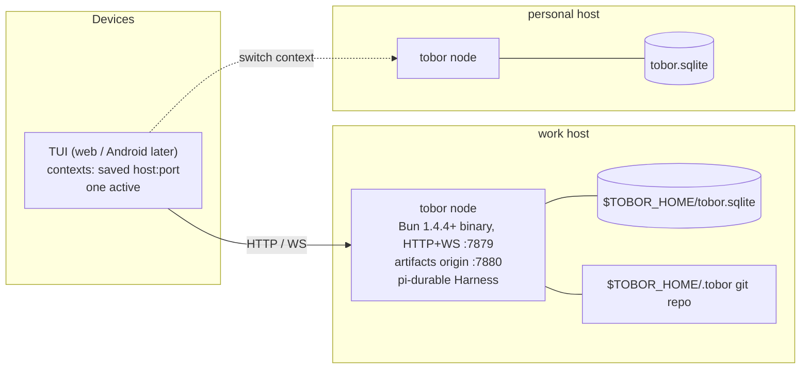
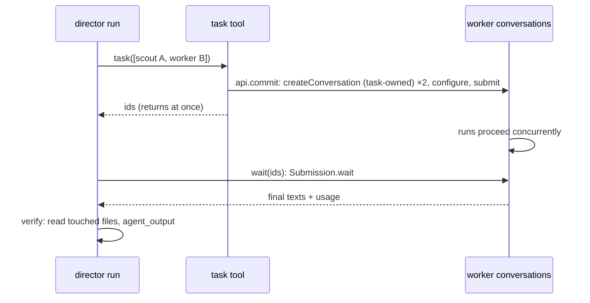

# tobor v3: remote agent harness on pi-durable

## Summary

tobor v3 is a lean, self-hosted remote agent harness. Each host runs one tobor Node process, and that process embeds the `@earendil-works/pi-durable` 1.5.1 library as its agent loop. The node serves an HTTP+WS API. Clients come in order: a **TUI** (`tobor tui [host:port]`, a remote client that runs on your laptop or over ssh on the host itself), then a web app, then a native Android app. From a client you start, watch, steer, approve, abort and schedule agent sessions on that host, and you edit the agent's context files. Sessions are durable conversations in one SQLite file, so they survive restarts and client disconnects.

v2 orchestrated omp child processes over RPC. v3 drops omp and pi-coding-agent and keeps only two things from omp:

- the **artifacts workflow** (self-contained HTML documents, published revisions, PDF export);
- the **hashline `read`/`edit` semantics** (`[path#TAG]` anchored line edits).

Most of what else omp provides (LSP, plan mode, profiles, codemode, collab) is out. Two omp-era capabilities come back in tobor's own small form: **director-mode subagents** (built on pi-durable task-owned conversations) and **MCP servers** (via `@modelcontextprotocol/sdk`). The goal is a small agent the owner can read end to end and deploy as a remote harness.

## Goals

- Start, stream, steer, follow up, approve, abort and resume agent sessions on a host from a terminal (TUI first; web and Android later).
- Durable sessions: a node crash or restart resumes unfinished runs (`harness.resume()`). A client reconnect rebuilds the view from current state.
- A small tool set the owner understands: `read`, `edit`, `write`, `bash`, artifacts, schedules.
- Director-mode subagents: the session agent plans, dispatches one-shot background workers, and verifies; workers search, edit and run. Agent definitions are data.
- MCP servers (stdio and http with static headers) as tool sources, with per-server approval policy.
- Hashline editing with exact, documented grammar and tag semantics (spec below), so edits are anchored and stale edits are refused.
- Artifacts: the agent publishes HTML documents, the node stores revisions and serves a viewer, and any revision downloads as PDF. The default theme is retro-log dark.
- Schedules: cron or one-shot prompts, created from the clients or by the agent, with a notification when the run settles.
- Agent context as data: `AGENTS.md`, `RULES.md`, `SYSTEM.md`, skills, agents, `config.yml` and design systems in a git repo on the host, edited from the clients. The layout mirrors omp's `.omp/` (see Agent data).
- One independent install per host. No hub and no sync. Contexts in the client are just saved `host:port` pairs.
- Nothing employer- or brand-specific in the source.

## Non-goals

- LSP, plan mode, codemode, tool search. None of these is in v3.
- MCP resources, prompts and OAuth-authenticated MCP servers in v3.0.
- Multi-user use or auth inside the node. There is one operator, and the network gates access.
- Cross-host anything: shared data, fleet views, a credential broker.
- Process or filesystem sandboxing. `NodeExecutionEnv` has no path confinement (PiDurableScout §5). Approval mode is the only guard.
- Bun, `bun build --compile`, or single-file binaries in v3.
- Chat-bot surfaces and inbound webhooks. Schedules are the only unattended way a run starts.

## v3.0 scope

Ships first: sessions (create, watch, steer/follow-up, abort, approvals, titles, archive/delete); hashline `read`/`edit` with `PUT` range/insert/append, `REM` and `MV`; `write`, `bash`; artifacts (store, viewer on its own origin, retro-log, PDF); schedules (new conversation per run); director-mode subagents (agent definitions, `task`/`wait`/`agent_output`, `todo`, workers panel); MCP (stdio + http with bearer/static headers, tool registration, approval mapping); agent data repo and editors; ntfy; `tobor init|node|tui|login|backup|version`; the **TUI** as the first client; **both** the Nix flake and the npm tarball (the owner runs both host types).

Deferred: the web app (after the TUI) and the Android app; `CUT` and registers; Web Push; schedule reuse of `conversation:<id>`; `POST /api/schedules/:id/run`; `artifact_export` format `html`; fork; manual compact; `.tobor` history/diff endpoints (`/api/tobor/history`, `/api/tobor/diff`); `tobor logout`; the Android placeholder directory; MCP OAuth servers, resources and prompts.

## Why pi-durable

| Option | Durability | Tool set | Auth / OAuth | Runtime | Fit |
|---|---|---|---|---|---|
| **pi-durable library (embedded)** | Conversations, runs, tool intents and sleeps persist in SQLite. `harness.resume()` continues unfinished runs. Partial output is persisted within ~1 s (`progress.persistWithinMs`). | Only what tobor registers: `CodingTools` plus `defineTool`, with same-name tools replacing earlier ones | pi-ai `builtinModels()`, a persistent `CredentialStore`, and `models.login('anthropic','oauth',…)` for Claude Pro/Max | Bun ≥ 1.4.4 (`node:sqlite` compat), no native addon | One process, typed API, `watch()` ops for remote replicas |
| pi coding agent SDK/RPC | The durable variant existed only as an experimental TUI at v1.0.0 and is gone on `main` | Full pi tool and extension surface | Same pi-ai auth | Node | Brings pi's settings, extensions and TUI baggage, with no headless durable surface |
| omp RPC (v2) | omp session JSONL, lease juggling, sibling-file moves | Large (subagents, LSP, MCP, plan mode…) | `omp login` into `agent.db` | 272 MB Bun binary per host | The bloat v3 is leaving behind. Approvals and streams need a translation layer |

**Decision:** embed pi-durable 1.5.1 in the tobor Bun process. It brings crash-safe runs, a tool set tobor fully controls, built-in Anthropic subscription OAuth, and a single runtime. The costs are the experimental API and the porting work for hashline and artifacts.

## pi-durable facts relied on

Pinned to **`@earendil-works/pi-durable` 1.5.1** with `pi-ai`, `chord` and `pi-schema`, all exact versions. README: "**Experimental.** The API changes without notice between releases." 1.5.0, a week before 1.5.1, removed `watchEvents()`/`AgentEvent`, changed watch listener signatures and moved the schema builders (`obj(...)` etc.) to pi-schema; `defineTool` itself stays in pi-durable. Every row below is tied to 1.5.1.

| Need | API (1.5.1) |
|---|---|
| Open | `Harness.open(await openNodeSqliteStorage(file), { models, registry, env, settings }, ctx)`. SQLite runs in WAL with `synchronous=NORMAL`; "commits survive process crashes" |
| Resume | `harness.resume()` starts the scheduler and continues unfinished runs. A submit or wait also starts it |
| Context | Every async call takes a Chord `Context`; `BACKGROUND_CONTEXT` never cancels |
| Conversations | `harness.createConversation({ ownership: {kind:"ownerless"} }, ctx)`, `tx.createConversation` inside a commit, `harness.conversation(id, ctx)`, `conversation.fork(entryId, …)`. No caller-chosen/deterministic ids |
| Per-conversation agent | `conversation.configure({ model:{provider,modelId}, thinkingLevel, tools, cwd, maxTurns, compaction }, ctx)`. Stored, and applied to the next request |
| Submit | `submit({type:"input", content, requestId?, whenBusy?: "steer"\|"reject"}, ctx)`. The default while busy is a follow-up. `requestId` makes admission idempotent. `Submission.wait` returns `done` or `unanswered{reason}` |
| Abort / reset / compact | `conversation.abort(ctx)`, `reset(handoff?, ctx)`, `compact(instructions?, ctx)`; automatic compaction via `settings.compaction` |
| Observe | `conversation.watch(ctx, window?)` gives `watch.value`, then `start(({value, ops}, ctx) => …)`. Ops are Chord ops; past 10,000 pending ops it sends one `["r", view]`. "Nothing is replayed" |
| Live state | `docs["pi.live"]`: `run`, `generation.message` (partial), `tools: ToolSlot[]` (`callId,name,status,output,…`), `runFailure`. Also `pi.inbox`, `pi.usage`, `pi.agent` |
| History | `conversation.entries(query: EntryQuery, ctx)` with `{minEntryId?, maxEntryId?, order, limit}`. `ConversationTranscript` provides `merge`, `loadEarlier`, `fillGap` and `.resume` (the reconnect window) |
| Entries | Kinds `pi.user`, `pi.assistant`, `pi.tool-result`, `pi.system`, `pi.reset`, `pi.compaction` |
| Tools | `defineTool({name, description, parameters: obj(...), replay?, execute(args, api, ctx)})` (pi-durable; `obj` from pi-schema). `api.output()`, `api.details()`, `api.commit()`, `api.env`, `api.callId`. Registry option `toolExecution: "sequential"` |
| Coding tools | `createBashTool`, `createWriteTool`, `createReadTool`, `createEditTool` from `/tools`. The edit tool is oldText/newText only |
| Env | `HarnessOptions.env: ({cwd}) => ExecutionEnv`, called per use. `env.cleanup()` releases it. No path confinement |
| Hooks | `hook(ToolTask, { beforeTool(call, api, ctx) → {block?, arguments?} \| Promise })`. "Recovery does not rerun `beforeTool`" once intent is committed |
| Replay | Intent is committed before `execute`. After a crash, only `replay:"safe"` tools rerun; the others give an `interrupted` error result |
| Tasks | `defineTask({name, version, initial, phases, abort, migrate})`, `background:true`, `runtime.sleepUntil(ms, {phase}, ctx)`, `runtime.commit`, `runtime.conversation(id, ctx)`. "A phase reruns from its top after a restart" |
| Docs | `defineDoc({kind, version, migrate, scope:"conversation", history, fork, initial, checkpointWhen})`, `tx.doc(Doc, id)`, `harness.snapshot`, `harness.watchDoc`, `harness.inspect()` |
| Prompt | Extension `sections`: `section(name, input => string, {tag?})`, in install order. Only changed sections are re-sent |
| Limits | `settings.restartLimit` defaults to 5 (counted per crash, reset by new commits). A storage error ends the Harness (`SessionFailed`). `contextRetentionMs`, `documentRetentionMs` |
| Run policy | `afterFailedRun: "withdraw"` drops queued input after a failed run |
| Models/auth | `builtinModels()` and `createModels({credentials})`. `CredentialStore {read,list,modify,delete}` is an interface tobor implements. `models.login(provider,'oauth',{prompt})` is Node-only. OAuth refresh runs inside `modify` |
| Writers | "One process writes a storage at a time; there is no cross-process locking" |

## Topology



There is one process per host and no hub. Hosts share nothing. Each node is plain HTTP on the port you choose and does no auth: whoever reaches the port is the operator. Tailscale (or another network control) gates access, and if TLS or auth is ever wanted, a reverse proxy adds it. In-node guards are request hygiene only (Host allowlist, Origin checks, JSON content type; see Security), and artifacts are served from a second listener so they never share the API origin.

## Node process components

**Boot sequence.** In order; the HTTP listeners open last:
1. Check `process.versions.node` ≥ 22.19, else exit with a message (the package also sets `engines` + `engine-strict`). Resolve `$TOBOR_HOME`: `--home`, then `TOBOR_HOME`, then `~/.local/share/tobor`.
2. Load `$TOBOR_HOME/.tobor/config.yml` and the `env_file`. Project-level `<git root>/.tobor/config.yml` is read per session cwd and merged under the whitelist in Agent data.
3. Build models with `createModels({credentials: fileStore("$TOBOR_HOME/auth.json")})` plus `builtinModels()`. The primary credential is the owner's Claude Pro/Max subscription via pi-ai's Anthropic OAuth (`models.login('anthropic','oauth',{prompt})`, run by `tobor login anthropic`); API keys from `env_file` are the fallback, and a stored OAuth credential wins over an env key. `fileStore` is tobor's own `CredentialStore`: a JSON file at 0600, mutations under a file lock with atomic rename, re-read on each call so the node picks up a login without restart.
4. Build the registry: one extension, `tobor`, holding sections, tools, hooks, the `tobor.schedule` task and the tobor docs. Every tobor doc and task has a `version` and a `migrate`.
5. **Open:** `Harness.open(await openNodeSqliteStorage("$TOBOR_HOME/tobor.sqlite"), {…, settings: {restartLimit: 10, afterFailedRun: "withdraw", contextRetentionMs, documentRetentionMs}})`.
6. **Resume:** `harness.resume()`.
7. **Reconcile schedules:** compare `tobor.schedules` with `harness.inspect()` tasks; create missing tasks for enabled definitions, abort orphans.
8. **Re-wait notifiers:** for each unsettled run submission in the schedule run lists, wait again and notify on settle.
9. **Rebuild pending approvals:** load `tobor.approvals` pending records into `GET /api/approvals` (resolvers attach when rerun hooks arrive).
10. **Listen:** API on `listen`, artifacts on `artifacts_listen`; probe Chrome (`--version`) and record the result for `/api/whoami`.

A tobor **session** is one ownerless conversation. Its `cwd`, model, thinking level and `maxTurns` are set through `configure`. Its `approval_mode` and title live in the doc `tobor.session`. The title defaults to the first 60 characters of the first prompt and is editable. The **`tobor.sessions`** index doc on the system conversation lists `{id, title, cwd, createdAt, archived}`; it is written in the create commit and on archive/delete, and backs `GET /api/sessions`. `harness.closed` is watched: if it settles `failed`, the process exits non-zero and systemd restarts it.

**Env per cwd.** `env: ({cwd}) => cache.getOrInsert(cwd, () => new NodeExecutionEnv({cwd, shellEnv: envFile}))`. The cache records last use and calls `env.cleanup()` and evicts after `defaults.idle`. `cwd` must `realpath` inside a `roots` entry when the session is created. Roots limit where a session starts, not what the agent can touch, and the UI says so.

**System prompt sections** are installed in this order:
1. `preamble`: tobor's short identity and working style; in `mode: director`, the director rules (see Subagents). If node-level `.tobor/SYSTEM.md` exists, its text replaces this section entirely (the director rules are still appended in `director` mode). Right after it, `.tobor/APPEND_SYSTEM.md` and then `<git root>/.tobor/APPEND_SYSTEM.md` are appended, if present.
2. `tools`: hashline read/edit guidance plus artifacts guidance.
3. `rules`: `.tobor/RULES.md`, then `<git root>/.tobor/RULES.md` if present.
4. `project_context`: `.tobor/AGENTS.md` first. Then, if present, `<git root>/.tobor/AGENTS.md` (project-level context, mirroring the per-node layout). Then every `AGENTS.md`/`CLAUDE.md` walking from `cwd` up to the git root, outermost first.
5. `skills`: a `name — description` list from `.tobor/skills/*/SKILL.md` frontmatter, with the path, followed by project skills from `<git root>/.tobor/skills/*/SKILL.md` (listed after node skills). The agent opens a skill with `read`.
6. `cwd`.

Context files are read at render time (no commit-keyed cache); pi-durable re-sends only sections whose text changed. No time or date section, because a varying section defeats prompt caching.

**Tools.** All tools (built-in and MCP) are registered globally in the one `tobor` extension; per-conversation visibility is set by `configure({tools, modelTools})` from the session mode or the worker's agent definition. Registered with `toolExecution: "sequential"` unless pi-durable exports `withFileMutationQueue`, in which case file-mutating tools route through it and the rest run in parallel; the director's own tools (`task`, `wait`, `read`, …) touch no files and run with `toolExecution: "parallel"`.

| Tool | Source | Approval in `ask` |
|---|---|---|
| `read` | tobor (`src/tools/read.ts`), hashline spec below. Replaces pi-durable `read`. Denies tobor's secret/state files under `$TOBOR_HOME` (`auth.json`, `agent.env`, `node.json`, `*.sqlite*`) | no |
| `edit` | tobor (`src/tools/edit.ts`), hashline spec below. Replaces pi-durable `edit` | yes |
| `write` | `createWriteTool()` wrapped with `wrapTool`: strips copied `N:` prefixes when every row has one and the numbers rise by 1, records a snapshot with `seen = "all"`, prepends `[path#TAG]` | yes |
| `bash` | `createBashTool()`; `prepareArguments` defaults the timeout to 10 min; output keeps the tail and spills to a file | yes |
| `artifact_create`, `artifact_publish`, `artifact_list` | tobor | no |
| `artifact_export` | tobor (pdf only in v3.0) | yes |
| `schedule_create` | tobor; cannot set `approval_mode: auto` | yes |
| `schedule_list`, `schedule_delete` | tobor | no |
| `todo` | tobor; writes the doc `tobor.todo` (per conversation: `[{id, text, status: pending\|doing\|done}]`), rendered in the Session view | no |
| `task` | tobor; spawns worker conversations (see Subagents) | only if it spawns an `approval: auto` worker |
| `wait`, `agent_output`, `agent_list` | tobor; read worker results | no |
| `agent_stop`, `agent_send` | tobor; stop a live worker, or steer it with a follow-up message | no |
| `mcp__<server>__<tool>` | registered from `mcp.json` (see MCP) | per `mcp.approval`, default yes |

**Approval.** `approval_mode: ask | auto` is set per conversation; the default comes from node `config.yml` (built-in default `auto`). `tobor.approvals` is declared with `fork: "initial"`, so a fork starts without the parent's session grants. In `ask`, a `beforeTool` hook on `ToolTask` gates `bash`, `write`, `edit`, `artifact_export`, `schedule_create`, MCP tools per `mcp.approval`, and `task` calls that spawn an `auto` worker:
1. Read `tobor.approvals`. A decision for `call.id`, or `session[toolName] === true`, proceeds (`undefined`); a stored deny returns `{block}`.
2. Otherwise commit a pending record `{callId, tool, args, createdAt}` keyed `(conversationId, callId)` to `tobor.approvals` **before** awaiting. The in-memory registry holds only the resolver. Emit `approval.requested` on `/api/events`, send ntfy, and await the promise raced against `ctx` cancellation, so an abort unblocks the hook and it blocks.
3. `POST /api/approvals/:callId {decision}` commits the decision (replacing the pending record), then resolves the resolver if present. The first decision wins; later posts return 409.
4. `approve` proceeds. `approve_session` also sets `session[toolName]=true`. `deny` returns `{block: "Denied by operator"}`.
5. After `approval_timeout` (default 12h) the hook commits `deny` with reason `timeout` and blocks.

`GET /api/approvals` reads the docs, so the pending list survives restarts. Limits: the wait is in memory, inside one tool-task phase, before intent is committed. [INFERENCE] A restart reruns that phase and the hook: a committed decision proceeds without asking; otherwise it re-attaches to the persisted pending record. Each crash during a wait counts toward `restartLimit` (set to 10); past the limit hooks stop running, and the spike must establish what state the call ends in. On SIGTERM with pending approvals the node exits without `harness.close()` (close would settle the waits); `TimeoutStopSec` in the unit matches the shutdown grace.

`auto` skips the hook. Loosening a conversation from `ask` to `auto` requires confirmation on the client.

**Schedules.** Definitions live in the doc `tobor.schedules` on a dedicated ownerless "system" conversation created at first boot (id in `$TOBOR_HOME/node.json`). A definition is `{id, name, cron? | at?, tz, cwd, prompt, model?, approval_mode?: ask, misfire_grace?: 2h, enabled}`. Each enabled schedule has one `tobor.schedule` task, `background: true`, owned by the system conversation. Creating, updating or deleting a schedule writes the doc and creates/aborts the task in **one** `harness.commit`. Phases:
- `wait`: compute `fireAt` from cron (`cron-parser`, `tz` defaulting to the host zone) or `at`, freeze it in the checkpoint, then `runtime.sleepUntil(fireAt, {phase:"create"})`.
- `create`: re-read the definition; deleted or disabled → finish `completed`. If `now - fireAt > misfire_grace`, record a skipped run with a notice and go to `wait`. If the previous run's submission is unsettled, record `skipped (overlap)` and go to `wait`. Otherwise, inside `runtime.commit`, `tx.createConversation` (ownerless), store config and the new id in the checkpoint, then go to `submit`. A rerun of `create` after the commit sees the frozen id.
- `submit`: configure the conversation, then `submit({type:"input", content: "[scheduled run, fired <fireAt ISO>]\n" + prompt, requestId: "<scheduleId>:<fireAt>"})`; the idempotent `requestId` makes a rerun harmless. Append `{fireAt, conversationId, submissionId, status}` to the run list (capped at 50). One-shot finishes; cron returns to `wait`. [INFERENCE] composed from documented parts; the README has no sleep-then-submit example.

  Run conversations are ownerless and listed in `tobor.sessions`. A per-process notifier waits on run submissions and notifies when they settle; at boot it re-waits unsettled ones.

**watch → WS.** One watch per socket. For each attached client:
1. Call `conversation.watch(ctx, window)`.
2. Send `{t:"snapshot", value}` first.
3. Forward each listener call as `{t:"ops", ops}`; the listener awaits socket drain (`bufferedAmount` below a threshold) before returning, so backpressure reaches pi-durable.

The client keeps a replica by applying Chord ops (the TUI via `chord/delta.apply`, proven); only one path is built. On disconnect the client keeps its `ConversationTranscript.resume` window and reconnects with it as `from`. Older history comes from `GET …/entries` with `EntryQuery` parameters. The client shows `pi.live.runFailure` and `unanswered{reason}` on the session.

**Storage.** `tobor.sqlite` holds pi-durable state plus the tobor docs (`tobor.session`, `tobor.sessions`, `tobor.approvals`, `tobor.schedules`, `tobor.todo`, `tobor.workers`). The artifact feed is `feed.jsonl`. There is no second transcript copy. Retention is set via `contextRetentionMs`/`documentRetentionMs`; `tobor backup <file>` runs `VACUUM INTO`.

## Subagents (director mode)

**Agent definitions are data.** `$TOBOR_HOME/.tobor/agents/<name>.md` (and `<git root>/.tobor/agents/<name>.md`, which shadows a node agent of the same name) has frontmatter `{name, description, model?, thinking?, tools?: [..], max_turns?, approval?: inherit|auto}`; the body is the worker's system instructions (rendered as its `preamble`; the other sections are shared). `tools` entries are tool names or `mcp__<server>__*` globs. `tobor init` ships four generic defaults:

| Agent | Purpose | Tools |
|---|---|---|
| `worker` | judgment work, the default | full set |
| `fast` | mechanical edits and data collection; cheaper model | full set |
| `scout` | read-only research | `read`, and `bash` with a deny-pattern list (redirects, `rm`, `mv`, `git commit/push`, package installs…). A guardrail against mistakes, not containment |
| `reviewer` | read-only review of finished work | as `scout` |

**Modes.** `config.yml: defaults.mode: director | solo`, overridable per session (`POST /api/sessions {mode}`, stored in `tobor.session`). `solo` is the classic single agent with the full tool set. In `director`, the `preamble` section renders the director rules and the director's `modelTools` are limited to `read`, `todo`, `task`, `wait`, `agent_output`, `agent_list`, `agent_stop`, `agent_send` and the artifact tools. Workers get the tools from their definition.

**Director rules** (rendered text, condensed): you are a director for one-shot background workers, not a worker. Workers search, edit, run and build; you plan, dispatch and verify. Own the todo list. Split work into small independent tasks with clear file boundaries; spawn every independent task in one `task` call; `wait` only when blocked. Each brief is complete and self-contained (goal, target files, non-goals, interfaces, acceptance), one concern per worker, and one worker owns each shared file. Workers skip build/lint/tests mid-flight; one worker runs them after all land. Verify every result by reading the touched files and the worker's output. Report only exercised evidence. Pick agents by tier: `fast` (mechanical), `worker` (judgment), `scout` (research), `reviewer` (review).

**`task({tasks: [{agent, name?, task, context?}]})`.** Inside one `api.commit`, for each item: `tx.createConversation({ownership: {kind: "task", taskId: api.taskId}})`, configured from the agent definition (model, thinking, `tools`/`modelTools`, `maxTurns`) plus the parent's `cwd`; the worker's `approval_mode` and name go into its `tobor.session`, and a record `{id, name, agent, conversationId}` into the parent's `tobor.workers` doc. Then it submits `context + "\n\n" + task` with `requestId: "<callId>:<i>"` (idempotent on rerun) and returns at once with `[{name, id}]`. Worker runs are ordinary durable runs. Items in one call run concurrently. `max_workers` (default 8) caps live workers per session; excess items return an error entry. [INFERENCE] If the tool task sits in `completing` while owned worker conversations run and that stalls the director's run, the spike falls back to a `background: true` `tobor.worker` task created by the tool as owner.

**`wait({ids?})`** (default: all unsettled workers) is declared `replay: "safe"`. It reacquires each worker submission with `harness.submission(id)` and awaits `Submission.wait`, then returns each worker's final assistant text (`settled.answer` entry), status/`unanswered` reason and `pi.usage`. Durability comes from the submissions, not the wait: after a crash the tool reruns and waits again. [INFERENCE] pi-durable's documented durable `waiting` is `on: TaskId[]`, not submission ids; whether a worker's run task id is usable there is an open question.

**`agent_output({id, before?, limit?})`** returns a worker's final text and pages its transcript via `conversation.entries`. `agent_list()` lists the session's workers; `agent_stop({id}|{all})` aborts live ones; `agent_send({id, message})` submits a follow-up to a live worker and the holder then awaits that newest submission. A correction to a finished worker is a new `task`.

**Approval.** A worker inherits the session's `approval_mode` unless its definition says `auto`. Approval cards and ntfy show the worker name. The director's `task` call needs approval in `ask` only when it spawns an `approval: auto` worker.

**Limits and abort.** `max_turns` per worker becomes `maxTurns`; a per-worker cost cap watches `pi.usage` and aborts the worker past it. Aborting the parent run aborts owned workers (abort is bottom-up through the task graph).

**UI.** The Session view shows a workers panel (name, agent, state, cost, last text) from `GET /api/sessions/:id/workers`; each opens as its own transcript through the same watch API on the child conversation id.

## MCP

`$TOBOR_HOME/.tobor/mcp.json`: `{ "servers": { "<name>": { "type": "stdio", "command", "args", "env" } | { "type": "http", "url", "headers" } } }`. `<git root>/.tobor/mcp.json` has the same shape; its servers merge in (a project server shadows a node one by name) and require approval before first connect by default. `${VAR}` placeholders are expanded from `env_file`, so tokens stay out of the repo. The client is `@modelcontextprotocol/sdk`, pinned exactly.

- **Registration.** During boot step 4, before the harness opens, and on each `mcp.json` commit, the node connects each server, calls `listTools`, and registers each tool as a pi-durable `defineTool` named `mcp__<server>__<tool>`: the MCP JSON Schema passed through as `parameters` (`{open: true}` when needed), `replay: "unsafe"`, `execute` = `callTool`, text and image content mapped to `output`, other content to `details`.
- **Down servers.** While a server is disconnected its tools stay registered and return an error result; the node reconnects with backoff.
- **Approval.** MCP tools require approval in `ask` by default. `config.yml: mcp.approval: { "<server>": auto | ask | { allow: [tools], ask: [tools] } }` (node-level only).
- **Visibility.** Director and agent `tools` lists may include `mcp__<server>__*`; `solo` sessions see all MCP tools.
- **Out of v3.0:** resources, prompts, sampling, and OAuth servers (static bearer headers only).
- `GET /api/mcp` → `[{server, type, status: connected|connecting|error, error?, tools}]`.

## Hashline read/edit spec

Lines are 1-based. Only CRLF is normalised (to LF) for addressing; each line keeps its own original terminator on write, and new lines get the file's dominant terminator. A leading BOM is stripped and restored.

### Tags

- `TAG` = the first 2 bytes of SHA-256 over the UTF-8 LF-normalized content, as 4 uppercase hex digits. tobor defines its own hash because omp's is undocumented.
- The **snapshot store** is in memory, per conversation, keyed by `absPath` then `TAG`. It holds `{fullHash (SHA-256), seen: Set<line> | "all", at}` and no content, since stale tags are never rebased. Up to 64 snapshots per conversation, LRU.
- `read` (non-raw) records a snapshot and adds the displayed line numbers to `seen`. Context lines count as displayed. A re-read of the same tag unions into `seen`.
- `write` records `seen = "all"`. A successful `edit` remaps the previous `seen` through the edit's line map, then adds the preview rows.
- Error replies that print `N:TEXT` rows add those rows to `seen` under the tag they report.
- Validation: look up the path, then the TAG. A record is valid if its `fullHash` equals the current content's. A tag that equals the current file's tag is accepted even with no record (e.g. after a restart), with an empty `seen`. `unknown_tag` only when the tag matches neither.

### `read`

Args: `{ path: string }`. The selector is a suffix on `path`:

```
selector := ":" ( "raw" | range ("," range)* ) [ ":raw" ]
range    := N | N "-" | A "-" B | A "+" C | "-" N
```

| Form | Meaning |
|---|---|
| `:N`, `:N-` | Line N to end (subject to the limit) |
| `:A-B` | Inclusive A..B; requires B ≥ A |
| `:A+C` | C lines from A; requires C ≥ 1 |
| `:-N` | Last N lines |
| `:a,b,…` | Ranges sorted and merged; exact, no context |
| `:raw` | Verbatim file text: no header, no prefixes, no context, no seen record |
| `:0` | Error: `Line selector 0 is invalid; lines are 1-indexed. Use :1.` |

Rendering rules:
- First line `[<path as given, cwd-relative if under cwd>#TAG]`, then one row per line, `N:TEXT`.
- A single bounded range (`A-B`, `A+C`) also shows 1 line before and 3 after, clamped to the file.
- Open-ended reads (none, `:N`) stop after 300 lines, followed by `[… more lines; continue with <path>:<next>]`.
- Lines longer than 2000 characters are cut with `…`. A cut line is not marked seen.
- An out-of-bounds start returns `File has L lines; try :1 or :L`, not an error.
- Binary files (NUL in the first 8 KiB) return a notice unless `:raw` is given. Images are delegated to a private `createReadTool()` instance called directly.
- Directories list their entries, one per line. No tag.
- tobor's secret/state files under `$TOBOR_HOME` (`auth.json`, `agent.env`, `node.json`, `*.sqlite*`) are refused; everything else is readable.

### `edit`

Args: `{ input: string }`. Grammar (an optional `*** Begin Patch` / `*** End Patch` wrapper is stripped). v3.0 ships `PUT` with a body, `REM` and `MV`; `CUT`, pastes and registers are deferred and rejected as `parse`:

```
patch    := section+
section  := "[" PATH "#" TAG "]" NL op+
op       := put_body | "REM" NL | "MV" SP dest NL
put_body := "PUT" SP target ":" NL body
target   := N ".=" M | "<" N | ">" N | ">$"
body     := ("+" TEXT NL)+          ; "+" alone = blank line; "++x" = "+x", "+-x" = "-x"
dest     := path | '"' path-with-spaces '"'
```

- PATH is everything between `[` and the last `#`. Paths resolve via `env.absolutePath`.
- `PUT N.=M:` replaces original lines N..M (inclusive) with the body.
- `PUT <N:` inserts before line N. `PUT <1:` is the file head.
- `PUT >N:` inserts after line N. `PUT >$:` appends.
- `REM` deletes the file. `MV dest` writes the edited result to `dest` (creating parents), then deletes the source.
- All numbers refer to the tagged snapshot, never to earlier hunks. Same-path sections in one call are merged so their anchors apply to one snapshot together.
- Block forms (`N*`, `>N*`) are rejected with `block anchors (*) are not supported; use an explicit range N.=M after reading the block`.
- Execution: parse and validate every section, compute every result, then write. Each output goes to a temp file in the target directory and is renamed into place. Additive targets (edits, `MV` destinations) land first; deletions (`REM`, `MV` sources) last. Across filesystems `MV` copies then unlinks. Snapshots for written destinations are invalidated. An OS failure mid-way can leave earlier files written; this is reported.
- A section whose result is byte-identical returns a `no_change` diagnostic and writes nothing. The third consecutive identical no-op call in a conversation is an error. In a multi-section call, any no-op rejects the batch.
- Success output per file: `[path#NEWTAG]`, then a compact preview (changed lines ±2 as `N:TEXT`), then `Warnings:` if any. `details: {diff, firstChangedLine}` for the UI.

Validation (`details.errorKind`):

| errorKind | Cause | Reply |
|---|---|---|
| `missing_tag` / `unknown_tag` | No `#TAG`, a placeholder (`#AUTO`, `#????`), or a tag matching neither a record nor the current file | Current `[path#TAG]` |
| `stale_tag` | Tag recorded, but the file's full hash changed | Fresh `[path#TAG]` plus `N:TEXT` for the anchored lines ±3 (marked seen) |
| `other_file_tag` | Tag belongs to a different path | Current tag |
| `unseen_lines` | Anchor or replaced line not in `seen` | Ranges to re-read |
| `header_only` | Section with no ops | — |
| `out_of_range` | N or M outside 1..L, or `M < N` | File length |
| `parse` | Bad header, body under a bodyless op, empty body on `PUT …:`, unified-diff rows (`@@`, `-old`), `*` forms, `CUT`/paste (deferred), overlapping ranges, bad `MV` destination | Line and reason |
| `no_change` | Third identical no-op | — |
| `file_not_found` / `io` / `write_failed` / `invalid_utf8` | Filesystem | OS message |

Stale tags are never auto-rebased in v3. omp's "unique safe result" recovery is unspecified, so tobor always asks the model to re-anchor.

## Artifacts and themes

This is a port of `omp-artifacts` (TypeScript; `design.ts` and `export.ts` are lifted, with Bun APIs swapped for Node: `Bun.file().type` becomes a mime table, `Bun.which` becomes a PATH scan). The store's internals are tobor's own, modeled on agentuse's observable behavior.

- **Bundles:** `<git root>/.tobor/artifacts/<slug>/index.html` plus `assets/`; bundles live with the project, as in omp. HTML only. Slug matches `^[a-z0-9][a-z0-9-]*$`. Limits: 25 MiB, 200 files. Skips `node_modules .git dist build coverage __pycache__`. Local `.js` files other than the vendored scaffold scripts are dropped.
- **Store:** `$TOBOR_HOME/artifacts/feed.jsonl` plus `store/<projectId>/<slug>/<rev>/`, and `pdf/<rev>.pdf`. `projectId` = `"proj_" + sha256(key).slice(0,12)`, where `key` is `git:<first commit sha>` (with `:wt:<gitdir name>` for linked worktrees), else `path:<realpath>`. tobor's own content hash, `nextRevision` per `(projectId, slug)`, slug/title derivation and file lock with atomic rename. Dedupe: same content hash, title and tags **and** the stored bundle dir exists → `{deduped:true}`, no new revision.
- **Tools:** `artifact_create({slug, title, design?, layout?: screen|document})` scaffolds from the resolved theme (tokens as `<style>`, a vendored Tailwind runtime copied into `assets/` with the theme's config, fonts and logo as `data:` URIs; no CDN, so PDF works offline) plus an agentuse-style runtime shim (in-memory `localStorage` and clipboard, since the sandbox has no storage). It fails if the bundle exists. `artifact_publish({slug, title?, tags?})` returns `URL:` and `Revision:` lines and emits `artifact.published`. `artifact_list({all?})`. `artifact_export({slug, format: pdf, out?})` defaults to `<git root>/.tobor/exports/<slug>.pdf`.
- **Viewer:** artifacts are served only by the second listener, `artifacts_listen` (default API port + 1, e.g. 7880), a separate origin from the API. `/art/<projectId>/<slug>` (latest) and `/art/r/<rev>` (fixed); the web app embeds them in an iframe with `sandbox="allow-scripts allow-popups"` (no `allow-same-origin`, no `allow-popups-to-escape-sandbox`). Every artifact response carries tobor's own header CSP: `sandbox allow-scripts allow-popups; default-src 'none'; script-src 'unsafe-inline' 'unsafe-eval' 'self'; style-src 'unsafe-inline' 'self'; img-src 'self' data: blob:; font-src 'self' data:; connect-src 'none'; form-action 'none'; base-uri 'none'`. The sanitizer strips meta refresh, `<base>` and preload links; paths stay inside the revision dir; open viewers reload on `artifact.published`.
- **PDF:** `GET /art/<projectId>/<slug>.pdf` and `/art/r/<rev>.pdf` render with headless Chromium using omp-artifacts' flags and `printReady` CSS. Chrome is found via `TOBOR_CHROME`, then PATH; a startup probe reports it in `/api/whoami`. Output is cached per revision; while that revision is rendering, requests get 503 with `Retry-After`. Streamed with `Content-Disposition: attachment`. Rendering is serialized, with a 120 s timeout.
- **Themes:** `$TOBOR_HOME/.tobor/design-systems/<name>/` (project-level `<git root>/.tobor/design-systems/<name>/` allowed and shadows by name) contains `design-system.md`, `tokens.css`, `tailwind.config.js`, `assets/fonts/*`, `assets/images/*`. A file whose name matches logo/mark becomes the header logo. Resolution order: the `design` arg, then `config.yml: artifacts.theme`, then the built-in `retro-log`.
- **Built-in default: retro-log, dark.** Shipped in `src/artifacts/themes/retro-log/`. `tokens.css` maps the semantic names to the dark retro-log values:

| Semantic | Value | Semantic | Value |
|---|---|---|---|
| `--color-bg` | `#2A2420` | `--color-primary` | `#E0A23B` |
| `--color-surface` | `#332C27` | `--color-primary-fg` | `#2A2420` |
| `--color-sunken` | `#211C19` | `--color-success` | `#A3BE8C` |
| `--color-fg` | `#EADFC6` | `--color-warning` | `#EBCB8B` |
| `--color-muted` | `#C2B59C` | `--color-error` | `#D8858B` |
| `--color-border` | `rgba(234,223,198,.4)` | `--color-border-strong` | `#EADFC6` |
| `--font-display` | `'Righteous',sans-serif` | `--font-sans` | `'Courier Prime',Courier,monospace` |
| `--font-mono` | `'Courier Prime',Courier,monospace` | `--radius-sm`/`--radius-md` | `3px`/`6px` |

  Also: `--font-type:'Special Elite','Courier Prime',monospace` (captions and labels only; code never uses Special Elite), `--color-accent:#E8865A`, `--shadow-sm:0 3px 0 rgba(0,0,0,.2)`, `--shadow-card:none`. `tailwind.config.js` extends `colors`/`fontFamily`/`borderRadius`/`boxShadow` with `var(--…)`. The fonts Righteous, Special Elite and Courier Prime are embedded as woff2 `data:` URIs in `@font-face`. `design-system.md` carries the retro-log usage rules: the four-stripe band once per page at the top, one stamp per page, numbered entries, one filled button per page, no Special Elite paragraphs.

## Agent data (.tobor dirs)

tobor mirrors omp's `.omp/` layout. Two locations use the same names: the node-level `$TOBOR_HOME/.tobor/` (omp's counterpart is the user dir `~/.omp/agent/`), and the project-level `<git root>/.tobor/` (omp's `<project>/.omp/`). The node-level dir is a git repo created by `tobor init`, and the node commits every client edit. The project-level dir belongs to the project's own repo; the node never commits it.

| Path | Level | Purpose |
|---|---|---|
| `AGENTS.md` | node, project | Context. Project loaded after node |
| `RULES.md` | node, project | Sticky rules |
| `SYSTEM.md` | node | Optional full replacement of the `preamble` section |
| `APPEND_SYSTEM.md` | node, project | Optional text appended after `preamble` (node, then project) |
| `config.yml` | node, project (whitelist) | Settings; see below |
| `mcp.json` | node, project | MCP servers (see MCP). Project servers merge in and need approval by default |
| `skills/<name>/SKILL.md` | node, project | Frontmatter: name, description |
| `agents/<name>.md` | node, project | Agent definitions; project agents shadow node agents by name |
| `design-systems/<name>/` | node, project | Themes (see Artifacts and themes) |
| `artifacts/<slug>/` | project only | Artifact bundles, living with the project as in omp |
| `exports/` | project only | PDF/HTML exports |

**Project `config.yml` whitelist:** `defaults.model`, `defaults.thinking`, `defaults.mode`, `artifacts.theme`, and additions under `mcp.servers`. Any other key is ignored with a warning. A project config can never loosen approval or touch `listen`, `roots` or hosts. The rest of this section describes the node-level `config.yml`:

```yaml
roots: [~/repos]         # default: [$TOBOR_HOME]
env_file: agent.env          # relative to $TOBOR_HOME, never inside .tobor/
listen: 0.0.0.0:7879
artifacts_listen: 0.0.0.0:7880   # default: listen port + 1
public_url: http://host:7879
artifacts_url: http://host:7880
allowed_hosts: [host, host:7879, host:7880]
allowed_origins: [http://host:7879]
notify: { ntfy: { url: https://ntfy.sh, topic: tobor-<random> }, on: [approval, error, settled] }
defaults:
  model: anthropic/claude-fable-5
  thinking: high
  approval_mode: auto
  max_turns: 100
  mode: director             # director | solo
  max_workers: 8
  idle: 30m                  # release the env cache of an idle cwd
  approval_timeout: 12h
retention: { context: 30d, documents: 90d }
mcp: { approval: { github: { allow: [list_issues], ask: [create_issue] } } }
artifacts: { theme: retro-log }
```

Validation runs before commit: YAML schema, frontmatter, and a theme directory that contains `tokens.css`. An invalid file is rejected with the error. Changes apply to the next request.

### Self-editing

The agent may edit its own `.tobor/` files with the normal `read`/`edit`/`write` tools; approval mode applies as for any file.

- **Commits.** The node watches `.tobor/` (debounced fs watch) and commits agent-made changes as `agent: <summary>`, so history is uniform with client edits.
- **Validation.** The same checks run on every change: `config.yml` schema, SKILL/agent frontmatter, `mcp.json` shape. A failing change is reverted to the last commit and reported as a tool error result.
- **Hot reload, per file.** Prompt sections re-render on the next request; `mcp.json` reconnects servers and re-registers tools; `agents/` applies to the next `task`.
- **Guardrail.** Changes by the agent to `config.yml: defaults.approval_mode`, `mcp.approval`, `roots`, `allowed_origins`, `allowed_hosts` or `listen` are rejected regardless of mode. Those keys are operator-only, via the API.
- **`tobor-self` skill.** `tobor init` ships a `tobor-self` skill under `skills/` that describes the layout and these rules.
- **`tobor init` skeleton.** `AGENTS.md`, `RULES.md`, `config.yml`, an empty `mcp.json`, `agents/{worker,fast,scout,reviewer}.md`, `skills/{artifacts,tobor-self}/SKILL.md`, and an empty `design-systems/` (retro-log is built in).

## API

All JSON; mutating requests require `Content-Type: application/json`. Every request's `Host` must be in `allowed_hosts`; every mutating request and every WS upgrade must carry an `Origin` in `allowed_origins`.

### REST

- `GET /api/whoami` → `{host, version, build, pi_durable: "1.5.1", node, public_url, artifacts_url, ntfy_topic, chrome: {found, version?}, now}` (`build`: content hash of the binary's sources from `build/gen-assets.ts`, `dev` from source)
- `GET /api/sessions` → `[{id, title, cwd, model, approval_mode, state: idle|running|waiting|failed, failure?, pending, usage, updatedAt}]` (from `tobor.sessions` plus live state)
- `POST /api/sessions {cwd, model?, thinking?, approval_mode?, prompt?}` → `{id}` (create, configure, submit; without `prompt` the session is created idle with no turns)
- `GET /api/sessions/:id`, `PATCH /api/sessions/:id {title?, model?, thinking?, approval_mode?, archived?}`, `DELETE /api/sessions/:id`
- `POST /api/sessions/:id/input {content, mode: prompt|steer|follow_up, requestId}` → `{submissionId}`
- `POST /api/sessions/:id/abort`
- `GET /api/sessions/:id/entries?minEntryId=&maxEntryId=&order=asc|desc&limit=` (`EntryQuery`)
- `GET /api/approvals` → pending records from `tobor.approvals`; `POST /api/approvals/:callId {decision: approve|approve_session|deny}`
- `GET /api/sessions/:id/workers` → `[{id, name, agent, state, usage, lastText}]`
- `GET /api/agents` → agent definitions; `GET /api/mcp` → server status and tool counts
- `GET /api/models` (catalog plus auth status per provider)
- `GET /api/auth` → `{<provider>: {source: oauth|env|none, expiresAt?}}`. The API never returns tokens.
- `POST /api/auth/:provider/login/start` → `{url}` (starts the OAuth flow; the TUI prints the URL)
- `POST /api/auth/:provider/login/code {code}` completes the flow with the code Anthropic displays
- `GET /api/cwds` → `{roots, recent}`
- `GET/PUT/DELETE /api/tobor/files/*path`; `GET /api/tobor/history`, `GET /api/tobor/diff`
- `GET /api/artifacts?project=`, `GET /api/artifacts/:projectId/:slug/revisions`
- `GET/POST /api/schedules`, `GET/PUT/DELETE /api/schedules/:id`
- Artifacts origin only: `GET /art/:projectId/:slug`, `/art/r/:rev`, `/art/:projectId/:slug.pdf`, `/art/r/:rev.pdf`

### WebSocket

- `WS /api/sessions/:id/watch?from=<window json>`: node → client `{t:"snapshot", value}`, then `{t:"ops", ops}`, and `{t:"end", reason}`. Client → node: `{t:"ping"}` only; commands go through REST.
- `WS /api/events` is the node-wide feed: `session.state`, `approval.requested|resolved`, `artifact.published`, `schedule.fired`, `agent.committed`. It is lossy: on (re)connect clients refetch `/api/approvals` and `/api/sessions`.

## Key flows

### Prompt → approval → tool

```mermaid
sequenceDiagram
    participant C as client
    participant N as node (API)
    participant H as Harness
    participant K as beforeTool hook
    C->>N: POST /api/sessions {cwd, prompt}
    N->>H: createConversation + configure + submit(input)
    N-->>C: {id}
    C->>N: WS /watch
    N->>H: conversation.watch()
    H-->>N: value, then ops (generation partials)
    N-->>C: snapshot / ops
    H->>K: beforeTool(bash)
    K->>H: commit tobor.approvals pending(callId)
    K-->>N: register resolver + /api/events + ntfy
    C->>N: POST /api/approvals/:callId {approve}
    N->>H: commit tobor.approvals[callId]=approve
    N->>K: resolve promise
    K-->>H: undefined (proceed)
    H->>H: commit intent, execute bash, commit result
    H-->>N: ops (tool slot output, result entry)
    N-->>C: ops; run settles; notify "done"
```

[INFERENCE] If the node crashes between approval and intent, `resume()` reruns the tool phase and the hook finds the committed `approve`. The spike confirms this.

### Director → workers



### Schedule fire

```mermaid
sequenceDiagram
    participant T as tobor.schedule task
    participant H as Harness
    participant V as new conversation
    participant N as node notifier
    T->>H: wait: freeze fireAt, sleepUntil(fireAt, phase create)
    Note over T,H: process may restart; resume() wakes due sleeps
    H->>T: create: grace/overlap checks
    T->>H: runtime.commit(tx.createConversation), id frozen
    T->>V: submit: configure + submit {input, requestId: id:fireAt}
    T->>H: record run (cap 50), sleepUntil(next)
    V-->>N: submission settles
    N->>N: ntfy "schedule <name>: done", links to artifacts
```

## Security

- No auth in the node. Network reachability is the access control, so binding to the tailnet IP is recommended.
- Request hygiene against DNS rebinding and CSRF: `Host` allowlist on both listeners; `Origin` required and checked on every WS upgrade and every mutating request; JSON content type required for mutations.
- Artifacts are served from a separate origin (`artifacts_listen`) with the header CSP above, a `sandbox` directive, `connect-src 'none'`, no escape-sandbox popups and path containment, so artifact JS cannot reach the API.
- The agent runs as the operator, with full filesystem and shell access (no sandbox). `ask` mode is the opt-in safeguard (the built-in default is `auto`). `roots` gates only the starting cwd. `read` refuses tobor's secret/state files under `$TOBOR_HOME` (auth.json, agent.env, node.json, database). `schedule_create` needs approval in `ask` and cannot create `auto` schedules. Agent self-edits of `.tobor/` cannot change approval mode, `mcp.approval`, `roots`, `allowed_origins`, `allowed_hosts` or `listen` (see Self-editing).
- Secrets live in `env_file` and `auth.json` (mode 0600), never in the `.tobor` repo, and never in notifications. Payloads carry ids and titles only.
- OAuth login (`tobor login anthropic`, or the web Host view; see Login on a headless host) writes `auth.json`. The API exposes auth status, never tokens. [INFERENCE] Whether Anthropic's terms allow Pro/Max OAuth in a third-party harness is undocumented, and the operator's call.

## Deployment and `$TOBOR_HOME` layout

```
$TOBOR_HOME/                 # --home → TOBOR_HOME → ~/.local/share/tobor
├── tobor.sqlite (+ -wal, -shm)
├── auth.json                # tobor fileStore (CredentialStore), 0600
├── agent.env                # env_file
├── node.json                # system conversation id, ntfy topic
├── .tobor/                  # node-level git repo: AGENTS.md RULES.md SYSTEM.md APPEND_SYSTEM.md config.yml mcp.json agents/ skills/ design-systems/ (see Agent data)
└── artifacts/{feed.jsonl, store/, pdf/}
```

- Runtime: Bun ≥ 1.4.4, checked at startup and via `engines.bun`. tobor ships as one `bun build --compile` binary (`bun run build` → `dist/tobor`, x64-baseline; `build:arm64`), so hosts need neither Bun nor Node installed.
- Distribution, both in v3.0: the compiled binary, which embeds `package.json`, the init skeleton and the artifact themes/vendored Tailwind (extracted on first run to `$XDG_CACHE_HOME/tobor/assets/<hash>/`, found via `$TOBOR_ASSET_ROOT`), run as `~/.local/bin/tobor node`; and a Nix flake `packages.default` whose closure includes chromium, plus a home-manager module for the unit.
- systemd **user** unit template `tobor@.service` with linger, `EnvironmentFile=%h/.config/tobor/nodes/%i.env` (sets `TOBOR_HOME`), `ExecStart=%h/.local/bin/tobor node`, `Restart=on-failure`, `TimeoutStopSec` matching the shutdown grace. SIGTERM leads to `harness.close(ctx)` unless approvals are pending (then exit directly; see Approval).
- CLI: `tobor init`, `tobor node`, `tobor login <provider>` (primary credential: the owner's Claude Pro/Max subscription via pi-ai Anthropic OAuth, `models.login('anthropic','oauth',{prompt})`; `env_file` API keys are the fallback and a stored OAuth credential wins), `tobor backup <file>` (`VACUUM INTO`), `tobor version`. `tobor logout` stays deferred.
- Upgrades: a candidate version must open a `VACUUM INTO` copy of the production DB (resume, inspect, read docs) before it is deployed.
- Node SEA single-file binary: later, not v3.

### Login on a headless host

`tobor login anthropic` prints the authorization URL. The operator opens it on any device, approves, and pastes the code Anthropic shows (pi-ai's `manual_code` prompt path; the local callback server is only used when a browser is available on the host). The credential is written to `$TOBOR_HOME/auth.json` (0600) by tobor's file-locked `CredentialStore`. The running node picks it up without restart (the store re-reads per call), and refresh happens inside `modify`. A replaced binary, however, needs a node restart: at the end `tobor login` probes the node's `/api/whoami` and, when its `version`/`build` differ from the CLI's, prints `systemctl --user restart tobor@<name>` (the name is the `~/.config/tobor/nodes/<name>.env` whose `TOBOR_HOME` matches).

The TUI exposes the same flow: Login screen → `POST /api/auth/:provider/login/start` returns `{url}` (printed) → `POST /api/auth/:provider/login/code {code}` completes it. `tobor logout` stays deferred.

## Repo layout

Single package `tobor` (Bun):

```
package.json            # exact pins: pi-durable/pi-ai/chord/pi-schema; engines.bun; bun.lock + bunfig.toml (exact)
build/                  # gen-assets.ts (→ assets.generated.ts), compile-entry.ts (binary entry: asset extraction)
src/cli.ts
src/server/             # http.ts, artifacts-http.ts, ws.ts, api/*.ts, guard.ts, notify/ntfy.ts
src/server/harness/     # setup.ts, boot.ts, env.ts, sections.ts, approvals.ts, docs.ts, schedules.ts, credentials.ts
src/tools/              # read.ts, edit.ts, hashline/{parse,apply,snapshots,tag,render,write}.ts, write.ts, bash.ts
src/artifacts/          # store.ts, project.ts, design.ts, export.ts, sanitize.ts, viewer.ts, shim.js, vendor/tailwind.js, themes/retro-log/
src/tui/                # app.ts, replica.ts, components/{transcript,tool-slot,approval,workers,composer}.ts, theme.ts, contexts.ts
web/                    # later milestone placeholder: Preact + Vite + TS; retro-log dark CSS
test/                   # vitest; fixtures/ recorded watch ops and hashline cases
```

### TUI (first client)

`tobor tui [host:port]` is a remote client over the HTTP+WS API. It runs on your laptop, or over ssh on the host itself, and holds no node state.

- **Library:** `@earendil-works/pi-tui` 1.5.1, pinned with the other pi packages (3 deps, same Node floor). Renderer `TuiAltScreen`; layout `VStack[ header, ScrollView(transcript, follow:"end", primary), workers strip, composer Editor, status line ]`.
- **State:** the TUI holds a replica of the conversation view, built by applying WS `ops` with `chord/delta.apply`. Components are keyed per transcript block: a `Markdown` per assistant/thinking block updated via `setText`, a `Box` per tool slot showing status plus output tail (Enter expands), so only the streaming tail re-renders. Reconnect uses the `ConversationTranscript.resume` window; `loadEarlier` on scroll-top calls `GET …/entries`.
- **Screens:**
  - **Sessions:** `SelectList` overlay with title, state tag and cost. `n` starts a new session: cwd picker from `/api/cwds`, model picker from `/api/models`, approval mode, mode director/solo.
  - **Session:** transcript plus composer. Keys: Enter prompt, `Ctrl+S` steer while running, `Ctrl+F` follow-up, `Esc` abort, `Ctrl+A` approvals overlay, `Ctrl+W` workers, `Ctrl+O` open worker transcript, `Ctrl+P` model.
  - **Approvals overlay:** a card per pending approval: tool, args preview, approve / approve-for-session / deny.
  - **Workers:** name, state, cost, last line. Enter opens the worker's transcript through the same watch API on the child id.
  - **Artifacts:** `SelectList` of the feed. Enter prints the URL; `p` requests the PDF and saves it to `~/Downloads` locally when run from a laptop.
  - **Schedules:** list, create, delete.
  - **Agent files:** opens `$EDITOR` on a temp copy and PUTs it back via `/api/tobor/files`.
  - **Login:** `/api/auth/:provider/login/start` shows the URL and prompts for the code.
  - **Host/context switcher:** contexts saved in `~/.config/tobor/tui.json`; also shows whoami and Chrome status.
- **Theme:** retro-log dark palette mapped to pi-tui `MarkdownTheme`, `EditorTheme` and `SelectListTheme` (gold `#E0A23B` accents, cream `#EADFC6` text on dark brown). The stripe band is a 4-colour top rule in the band colours. pi-tui ships no themes; tobor supplies them in `theme.ts`.
- **Notifications:** a terminal bell plus an OSC 9/777 notification when an approval arrives and the TUI is attached. ntfy remains for phones.

### Web app (later)

Preact + Vite + TypeScript in `web/`, a later milestone after the TUI, using the retro-log tokens above and the same API (contexts in `localStorage`, artifacts in a sandboxed iframe). Its build is `embed`ded in the node so every node serves the identical app. Not in v3.0.

**Android:** Kotlin/Compose, a later milestone. Uses the same API, with ntfy notifications and Approve/Deny actions.

## Build order

1. **Spike (gate for everything else).** Pin pi-durable/pi-ai/chord/pi-schema exactly; run `models.login('anthropic','oauth')` with a `prompt` callback to confirm the `manual_code` path works without a browser on the host; open `openNodeSqliteStorage`, create one ownerless conversation; round-trip a bash tool call against a real model; register a `beforeTool` hook that awaits an externally resolved promise, kill the process mid-wait, establish whether the phase and hook rerun, how restarts count, and what happens past `restartLimit`; confirm `ctx` cancellation reaches the hook on abort; check whether `withFileMutationQueue` is exported; create a task-owned worker conversation from a tool, wait for its settle, abort the parent and confirm bottom-up abort; verify `chord/delta.apply` on recorded ops in Node (proven for the TUI; the web build re-checks it later); write fixtures (recorded ops streams plus final views).
2. Boot sequence, credentials + `tobor login`, sections, env cache, session API with `tobor.sessions`, request guards, WS watch, and a minimal TUI Session screen (transcript + composer) against the live node.
3. Hashline `read`/`edit` with a fixture-driven test suite (grammar, errors, tag validation, seen remap, merges, CRLF, MV/REM ordering).
4. Approvals end to end, with persisted pending records and ntfy.
5. TUI: approvals overlay, workers, artifacts, schedules, agent files, login, contexts.
6. Subagents: agent definitions, `task`/`wait`/`agent_output`/`todo` tools, workers panel data.
7. MCP: client, tool registration, approval mapping, status API.
8. Agent data repo and its files API.
9. Artifacts: second listener, store, tools, shim, vendored Tailwind, viewer, retro-log theme, PDF.
10. Schedules: task, doc, reconciliation, tools, API.
11. Packaging: npm tarball, Nix flake, systemd unit, `tobor backup`; deploy to both hosts.
12. Web app: Preact + Vite, `embed`ded in the node's static handler so every node serves the identical app.
13. Android app.

## Open questions

- **Durable approval primitive.** The wait is in memory per phase. Does pi-durable have, or will it get, a task wait on a document change or an external signal? `scheduler.ts` and the spec were not fully read. If one exists, model approval as a waiting task instead.
- **Durable wait on workers.** Can a task return `{status: "waiting", on: TaskId[]}` on worker run task ids, or does it need submission ids? Until known, `wait` is a `replay: "safe"` in-memory `Submission.wait`.
- **MCP restarts and tool drift.** A server restart mid-session can add, remove or change tools; how a changed registry reaches a running conversation's `tools` and prompt cache, and what happens to in-flight calls, is unresolved.
- **Read-only second process.** `HarnessOptions.readOnly` exists. A CLI inspector could open `tobor.sqlite` read-only next to the node. It would see only stored state, not live partials [INFERENCE]. It is not needed in v3.
- **Single-file binary.** Done via Bun: `bun build --compile` bundles everything, including `node:sqlite` users and dynamic imports; on-disk assets are embedded and extracted on first run.
- **pi-durable churn policy.** Pin exact versions. A weekly CI job runs `bun outdated` on the four packages, and runs the step-1 fixtures and the hashline suite against the latest version. Upgrades are manual, read the CHANGELOG, pass the fixtures, and open a `VACUUM INTO` copy of the production DB before landing.
